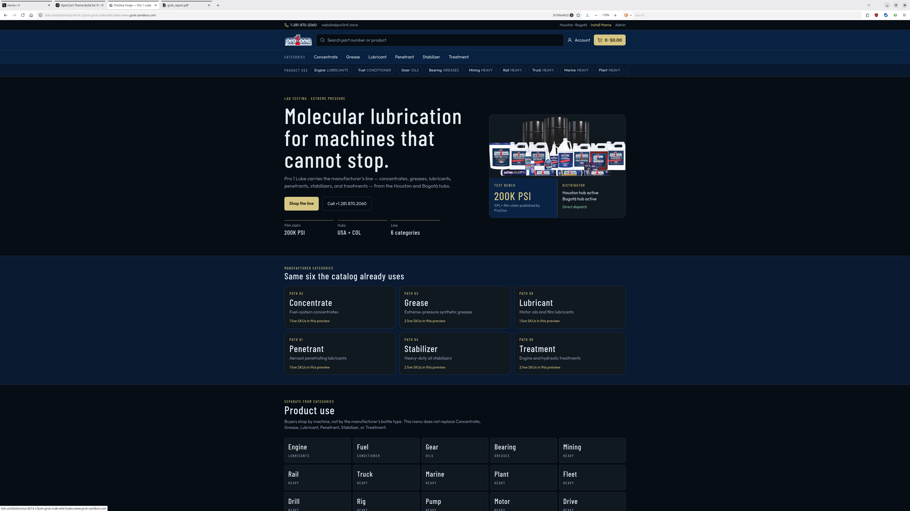
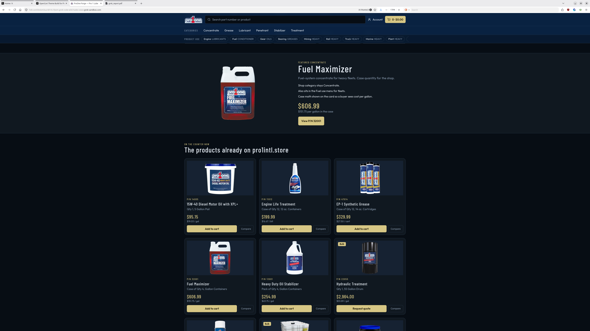
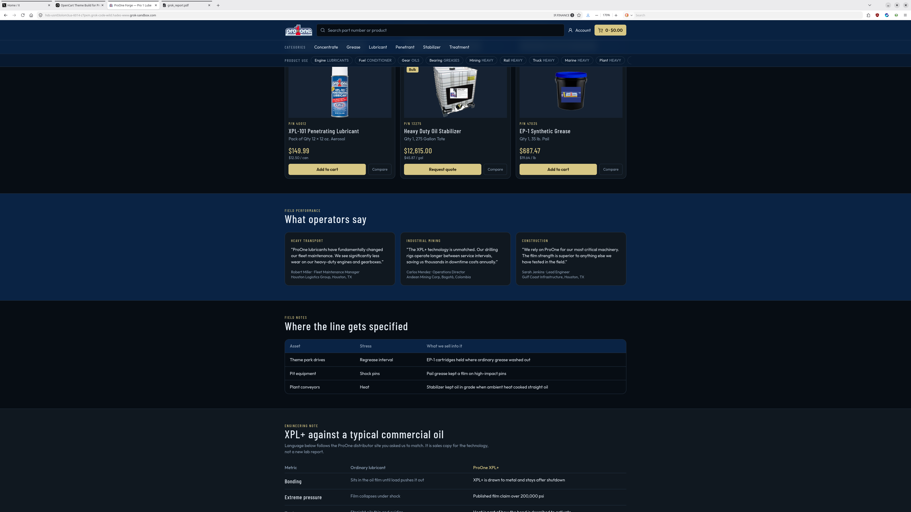
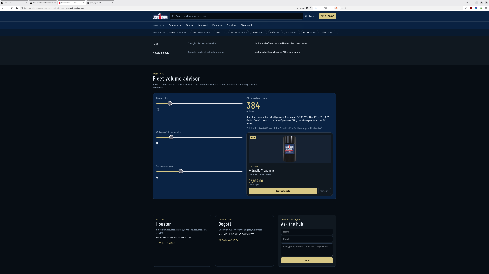
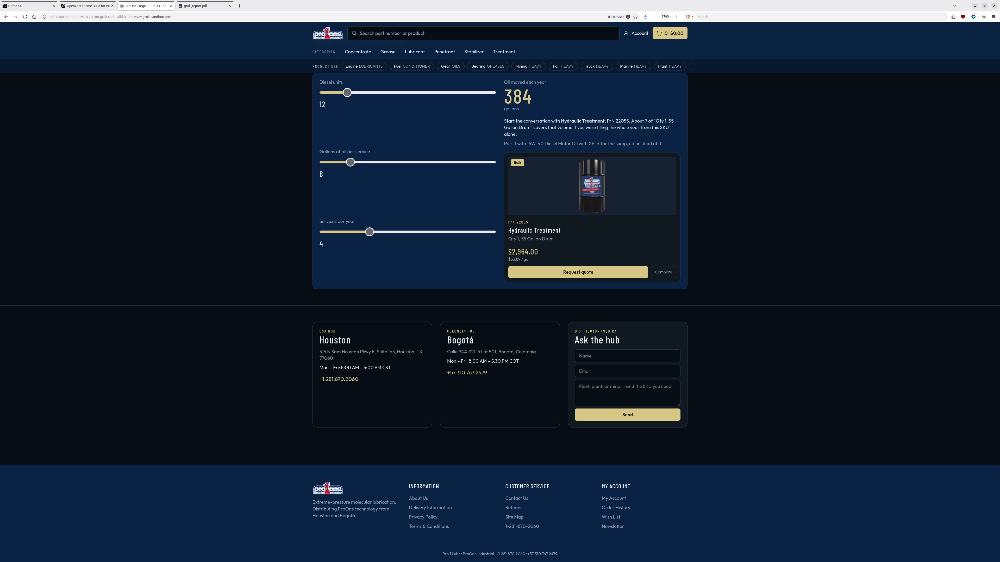
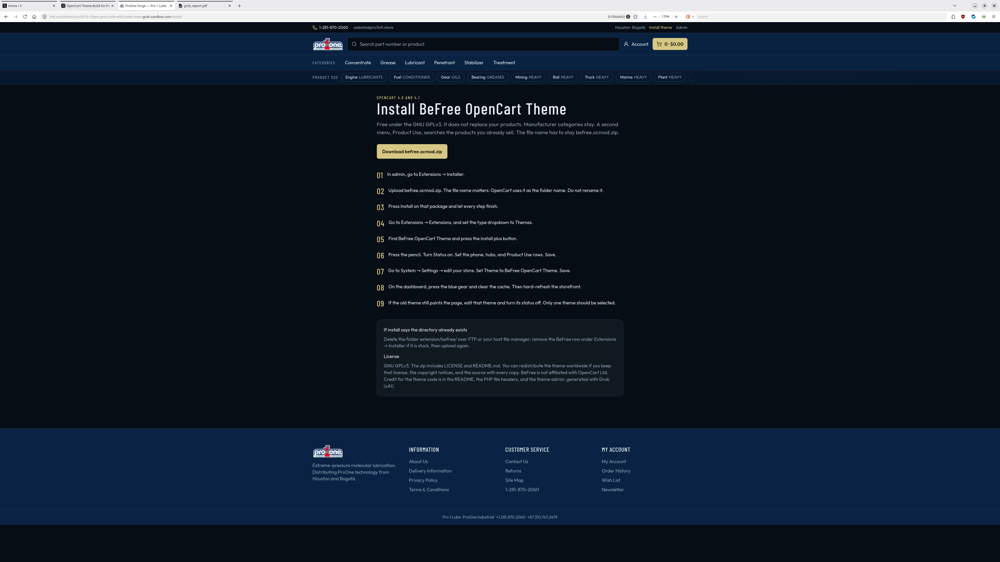

# BeFree OpenCart Theme

BeFree is a dark industrial storefront theme for OpenCart 4. Your real categories stay in the main menu. Product Use is a second bar that searches product names and models you already sell. Colors, the home hero, two hubs, and those search rows are edited in the theme admin.

The extension **code** OpenCart uses is `befree`. The name people see in Extensions and in System → Settings is **BeFree OpenCart Theme**. Both have to match the files in this package. Renaming only the zip is not enough.

Version 1.2.3.


## License

GNU General Public License version 3. The full text is in [LICENSE](LICENSE).

GPLv3 is the right license for this theme. OpenCart itself is GPLv3. A theme that runs inside OpenCart and replaces its templates should use a GPL-compatible license, and GPLv3 is the one that matches the core with no extra doubt. It is also what you asked for.

GPLv3 lets anyone, anywhere, use, copy, modify, and redistribute this theme, including commercially, if they:

- keep this license and the copyright notices with every copy
- ship the source (this package is the source: PHP, Twig, CSS, and JavaScript)
- license their changes under GPLv3 as well
- mark what they changed

It is not a trademark license. See below.

Copyright (C) 2026 BeFree OpenCart Theme contributors.

Generated with Grok (xAI). That credit is requested. It is not an extra restriction on the GPL.



## What you may not assume

This is not legal advice. For a contract, a marketplace dispute, or a trademark question, ask a lawyer in the countries where you distribute.

To redistribute this theme worldwide under GPLv3:

1. Give people the whole package, including `LICENSE` and this README. A zip of the source is enough. Do not distribute object code or a hosted-only build without the corresponding source.
2. Do not add terms that cancel the GPL (no "you may not resell this", no "internal use only") on copies you ship.
3. If you change it, say so, and keep the result under GPLv3.
4. **OpenCart is a trademark** of OpenCart Ltd. You may say this theme is for OpenCart, which is the ordinary way to name a compatible theme. Do not use the OpenCart logo as your logo, and do not say OpenCart Ltd made or endorses BeFree. A short line is enough: "BeFree is not affiliated with OpenCart Ltd."
5. Do not ship someone else's copyrighted text, photos, logos, or customer quotes inside your copy. The sample quotes in the home template are placeholders. Replace them, or turn Sample quotes off, before you present them as real reviews.
6. Phone numbers, addresses, and product claims in the theme admin are yours to fill in. The defaults are blanks and placeholders, not a real company.
7. Barlow Condensed and Outfit are loaded from Google Fonts. They are under the SIL Open Font License and are not part of this GPL work. The theme does not bundle the font files. If a store cannot reach Google, the browser falls back to a generic sans-serif.
8. Export and sanctions rules still apply to you as the distributor. A GPL theme does not exempt anyone from those laws.

You do not need a separate paid license from the author to sell stores that use BeFree, or to put BeFree on a download site, as long as the GPL conditions above stay intact.


## Credit

Please keep the credit. It is already in these places:

- this README
- the `LICENSE` grant, together with the copyright line above
- the comment at the top of each PHP file, `catalog/view/stylesheet/befree.css`, and the theme admin help text under Status

It is not printed on the public storefront. Stores you build should not have to show a Grok badge to their customers.



## Requirements

- OpenCart **4.0.0.0 through 4.1.x**, including 4.0.1.x, 4.0.2.x, 4.1.0.0, 4.1.0.3, and 4.1.0.4
- PHP 8.0 or newer, which OpenCart 4 already requires
- Not OpenCart 3, and not OpenCart 2. Those carts use a different extension layout and this package will not run there

The same zip is used for every OpenCart 4 release. The theme switches install and event syntax itself:

| OpenCart | What BeFree does differently |
| --- | --- |
| 4.0.0.0 | Startup is registered with separate arguments. Controller methods use `\|`. |
| 4.0.1.x | Startup is registered as one array. Controller methods still use `\|`. |
| 4.0.2.x | Controller methods use `.`. The view event receives 3 arguments. |
| 4.1.0.0 and later | Startup stores a description. The view event receives 4 arguments. Variant products (`master_id`) are hidden so child SKUs are not listed as their own products. |

That behavior follows the OpenCart source for those releases. It has not been click-tested on a live store of every 4.x build.

## Install




The uploaded file name **must** be `befree.ocmod.zip`. OpenCart names the folder from that filename: `extension/befree/`. If you upload `my-theme.ocmod.zip`, the code becomes `my-theme` and the theme will not load.

1. Admin → Extensions → Installer.
2. Upload `befree.ocmod.zip`.
3. Press Install on that package and wait until it finishes.
4. Extensions → Extensions → choose Themes.
5. BeFree OpenCart Theme → Install (+).
6. Edit (pencil) → Status On → Save. Set the phone, colors, Product Use keywords, and the two hubs. Leave a text field blank to hide it on the storefront. Sample sentences in a form you have not saved yet are only starting values. The X handle, share image, share description, and hub map links are optional and start blank.
7. System → Settings → edit the store → Theme = **BeFree OpenCart Theme** → Save.
8. Dashboard → blue gear → clear the theme cache. Hard-refresh the storefront.
9. If the previous theme still draws the page, edit that theme and turn its status off.

Product Use does not create categories. Categories stay in the main menu. Each Product Use row searches product names and models.

If products appear twice on the home page, Design → Layouts → Home → remove the Featured module. The theme already lists live products.

If install says the directory exists, delete `extension/befree/` by FTP, remove the stuck installer row, and upload again.

## Layout of the code

OpenCart reads these names. Do not rename them unless you change every reference.

```
befree.ocmod.zip
  install.json
  LICENSE
  README.md
  admin/controller/theme/befree.php          class Befree
  admin/language/en-gb/theme/befree.php      heading_title = BeFree OpenCart Theme
  admin/view/template/theme/befree.twig
  catalog/controller/startup/befree.php
  catalog/controller/finder/finder.php
  catalog/model/finder/finder.php
  catalog/view/stylesheet/befree.css
  catalog/view/javascript/befree.js
  catalog/view/template/...
```

Settings are stored under the code `theme_befree`. The store setting `config_theme` is the code `befree`.

Admin labels and the home-page chrome are English. Product names, categories, and the rest of OpenCart follow the store language.

## Changes in 1.2.3

- Product pages no longer pull in a separate badge template. OpenCart 4 cannot find that include, and every product page failed to load. The same badge markup now sits inside the product template. It is still off until a store turns it on. The wording is unchanged.

## Changes in 1.2.2

- Guest Checkout is easier to see. On the checkout register step it is a bold choice with the hint "No account needed". Register Account stays the default. This is on for every store using the theme.
- A row of payment badges can sit under Add to Cart. It is off until a store turns it on in the product template. The row says all payments are processed by PayPal. Apple Pay and Google Pay stay hidden until those are turned on inside the badge template.
- The badge and guest-checkout styles live in a new file, `payment-badges.css`, so the `befree.css?v=1.2.1` link from 1.2.1 is unchanged.

## Changes in 1.2.1

- Storefront text is easier to read on the dark background. Body text is 16px instead of Bootstrap's 13px. Small notes are at least 14px. Form labels are 15px instead of 12px.
- Headings are a light gray instead of OpenCart's #444, which was too dim on black. Product page titles and product card titles are white and bold, and they stay the same size.
- Information pages (terms, delivery, and the other information topics) use 17px body text and light headings. The stylesheet link for befree.css now includes `?v=1.2.1`, so a browser that cached the old file for up to 7 days picks up the new one.

## Changes in 1.2.0

- Product pages publish their own share card (Open Graph and X): the product name, a short plain-text description, a square photo, and the price. Other pages use the page title, the meta description, and the store logo when the store has one. A share image URL, a fallback description, and an X handle are theme settings. All three start blank, and a value that is not a public URL or a handle is ignored.
- Shelf cards show a special price when the product has one. The regular price is struck through.
- Each hub can take an optional map link. Paste an http or https URL. Leave it blank and the hub name stays plain text.
- On a small screen the category menu opens in an off-canvas panel. On a wide screen it stays one wrapping row. A category with more than eight children is shown in columns, and a long menu scrolls.
- Popup alerts use the dark theme. Links on light surfaces use the same dark lime as the side menu so they stay readable.
- A link with class `bf-em` and a reversed `data-e` value (`user|domain`, characters reversed) becomes a `mailto:` link. This package does not include an address.
- The 1600px header and footer stay off until you add the class `befree-wide`. See below.

## Changes in 1.1.2

- Optional 1600px wide header and footer. It is off by default, so existing stores look the same. Add the `befree-wide` class to the body tag to turn it on (see "Optional: wide header and footer" below).
- Side-menu links on light backgrounds use a readable dark lime (#3F6212, hover #365314).

## Changes in 1.1.1

- A saved blank text field stays blank on the storefront. Hub names, the highlight, the hero kicker, and the hero title no longer snap back to "Hub 2", "Your line", or the other sample sentences after you clear them.
- A field that has never been saved still shows its sample sentence. Saving that field blank is what clears it. A new install still opens with the samples filled in.
- The home hero lead is a theme setting. Until you save it, the storefront keeps the sentence it already used.
- Empty hub cards, empty stat blocks, and the dot or plus next to a missing hub name are not printed.

## Changes in 1.1.0

- Renamed from the single-store build to BeFree for redistribution.
- Removed the previous store's phone numbers, addresses, product claims, and named quotes from the defaults.
- Made one package cover OpenCart 4.0 and 4.1.

## Optional: wide header and footer (1600px)
Off by default. To widen the top bar, header, menu and footer to 1600px on screens 1200px and wider, change `<body class="befree">` to `<body class="befree befree-wide">` in `catalog/view/template/common/header.twig`. Nothing changes for stores that don't add the class.
